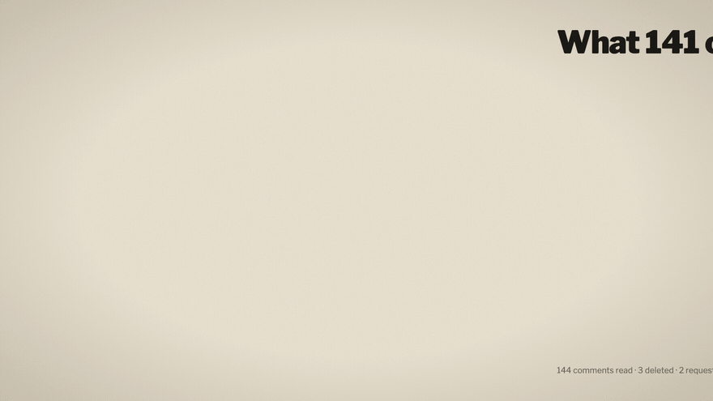

# Agentic SNS

**English** · [한국어](README.ko.md)

**Let Claude Code read X, Threads, Reddit, Facebook and Naver Blog through your own logged-in browser.** Read-only, account-safe, no API keys.

[](docs/media/demo.mp4)

<sub>Real run: one r/headphones thread, every comment read in 2 requests, grouped by Claude. [Full 45-second video](docs/media/demo.mp4).</sub>

> [!IMPORTANT]
> Requires the [Aside](https://aside.com) browser and its `aside` CLI, logged in to the platforms you want to read. Every request goes out as your real account, through a tab the skill opens for itself.

## Install

```sh
npx skills add tjdwls101010/Agentic-SNS
```

Or copy the folder by hand — it is self-contained:

```sh
git clone https://github.com/tjdwls101010/Agentic-SNS && mkdir -p ~/.claude/skills && cp -R Agentic-SNS/.claude/skills/sns ~/.claude/skills/
```

The skill never writes into its own folder, so reinstalling or updating keeps your state. Blocks, holds, pacing, the request log, sessions, continuation handles, result files and saved pictures live in `~/.local/state/agentic-sns/` (`$XDG_STATE_HOME/agentic-sns/` when that is set, or wherever `SNS_DATA_DIR` points), shared by every install on the computer. Pictures, result files and the handles that point at other people's posts are removed once they are a day old, the next time the skill saves one (an expired handle keeps only the command that remakes it, for a week). If you keep `SNS_DATA_DIR` elsewhere, reading a saved picture asks for permission.

**Updating from a version that kept `data/` inside the skill folder:** `npx skills add` removes the folder before the new version can run, which would drop the recorded blocks. Move the folder's `data/` aside first, update, put it back as the new folder's `data/`, and run any command once; the new version takes it in (and does so again whenever that `data/` changes). Update every copy of the skill you have: an old copy keeps writing to its own `data/`. Only this one update needs it.

You also need [Claude Code](https://claude.com/claude-code) and [uv](https://docs.astral.sh/uv/); the CLI is a dependency-free PEP 723 script (Python 3.11+), so `uv run` is all it takes.

## Ask in plain words

No platform name needed — a bare link is enough for the skill to pick one.

- "Read the whole thread on r/headphones about the new Walkman prices and tell me what people actually think."
- "How are the replies to https://x.com/… split? Quote one from each side."
- "Compare what Reddit and Threads say about this product this week."
- "Find Naver Blog reviews of this robot vacuum and separate sponsored posts from ones people bought themselves."

## Why this one

| | Typical API-key servers | Typical cookie-copy scrapers | **Agentic SNS** |
|---|---|---|---|
| Where requests come from | The platform's paid or rate-capped API | A background browser loaded with copied cookies | **Your own browser, in a tab of its own** — your other tabs are untouched |
| Writes to your account | Depends on the tool | Depends on the tool | **Never.** No posting, replying, reacting, following, saving or DMs |
| When the platform pushes back | The API returns an error | Varies by tool | **Stops** on a checkpoint or lock and waits until you clear it yourself |
| Threads, Facebook, Naver Blog | Seldom covered | Seldom covered | **Yes**, alongside X and Reddit |

## What it reads

| Platform | Commands |
|---|---|
| `x` | feed profile about graph me list community post replies reposts quotes search trends images doctor schema |
| `threads` | feed profile about graph me search post replies quotes reposts images doctor schema |
| `reddit` | feed sub profile about wiki search related me post comments images doctor schema |
| `facebook` | feed profile group post comments replies search about images me doctor schema |
| `naver-blog` | search keywords post comments images resolve about profile feed graph me topic monthly doctor schema |

Every surface each site shows a logged-in reader, and whether the skill reads it (or why not), is in [docs/surfaces.md](docs/surfaces.md).

Feeds, a post with its replies or full comment tree, quotes and reposts, profiles and followers, search, subreddits and wikis, Facebook groups and pages, X lists, communities and trends, Naver blogs with their categories, neighbors and topics, the pictures in a post, and your own saved, liked and notification items.

The CLI can be called directly too:

```sh
uv run .claude/skills/sns/scripts/cli.py --help                    # platforms and commands
uv run .claude/skills/sns/scripts/cli.py reddit post --help        # what one command takes, returns and costs
uv run .claude/skills/sns/scripts/cli.py reddit schema             # what result fields mean
uv run .claude/skills/sns/scripts/cli.py reddit sub r/apple --sort top --time week --limit 5
```

A result starts with what was shown, why it stopped, how many requests it used, what limit is left and the file that keeps the whole result for about a day (`saved=`), then what is missing (`coverage:`) and the command that continues (`more:`) — so output cut short still keeps them; each record ends with the commands that open it further (`replies <handle>`, `post <url>`). `--json` gives the same result as JSON and `--out FILE` collects a long read into a file. Exit codes are listed at the end of `--help`.

## Account protection

- **A person clears blocks.** On a checkpoint, challenge or lock the skill stops requesting that platform and records it. It reads again only after you solve it in the browser and confirm with `<platform> doctor --unblock`.
- **Limits and pacing are kept.** It follows the limits and reset times the platform reports, spaces requests, and logs every request per account. `<platform> doctor` shows login, blocks, limits and recent request counts.
- **One command finishes within two minutes.** At the deadline it returns what it read and the command to continue.
- **A dedicated tab only.** Platforms that need a tab are read only from the tab the skill opened, which it blanks when idle (`SNS_IDLE_SECONDS`, default 300). Your other tabs are never touched.

With several Aside accounts, pick one with `SNS_ASIDE_ACCOUNT` (per platform: `SNS_ASIDE_ACCOUNT_<PLATFORM>`).

## Repository layout

```
.claude/skills/sns/        the installed skill (complete on its own)
├── SKILL.md               judgment rules the model reads — scope of claims, how much to read, account ≠ person, account safety, Naver sponsorship cues
└── scripts/
    ├── cli.py             the single entry point (parser, dispatch, exit codes)
    └── sns/               shared core (protection, paging, deadlines, output) and platform packages (x, threads, reddit, facebook, naver_blog)
tests/sns/                 tests against a fake Aside, synthetic fixtures per platform
contrast/sns/              harness that measured SKILL.md against a bare skill, rubric, trigger evals
docs/video/                source of the demo video (Remotion); numbers come from build_scenes.py
docs/media/                rendered video, GIF, X card and GitHub social preview
```

## Development

```sh
uv run --with 'pytest>=9,<10' pytest -c tests/sns/pytest.ini tests/sns
```

Tests run against `tests/sns/fakes/fake_aside.py` instead of a real browser, with synthetic fixtures only. Live smoke tests against a real account run only with `SNS_LIVE=<platform>` (or `all`) and `-m live`.

`contrast/sns/` measures whether each section of SKILL.md actually improves the model's answers: the same tasks run on Opus and Sonnet with a bodyless skill (A) and the draft (B), graded blind against `rubric.md`. `contrast/sns/triggers/` measures when the skill is invoked, with `claude plugin eval`.

When a platform's site changes, only that platform's `scripts/sns/<platform>/web/` should need fixing: site formats live there alone.

The demo video is rebuilt from a real reading: `uv run docs/video/build_scenes.py <reading.ndjson> "<summary line>"`, then `npm run render` in `docs/video/`.
